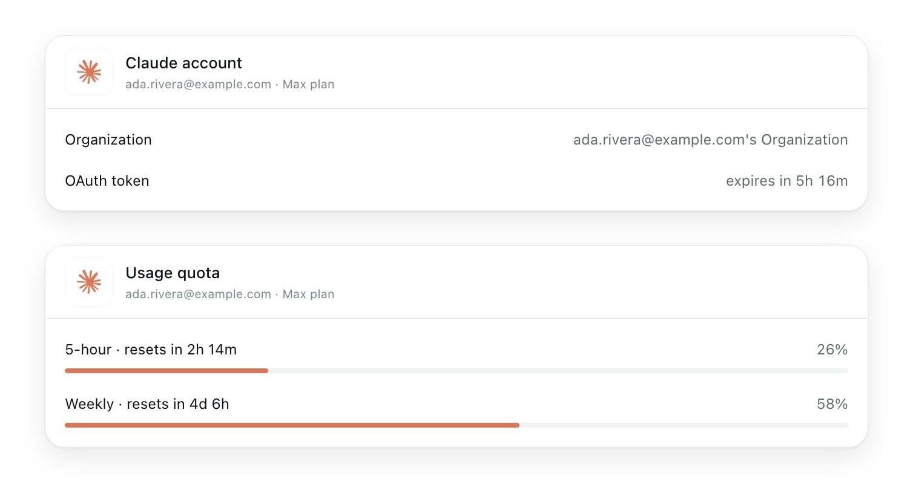
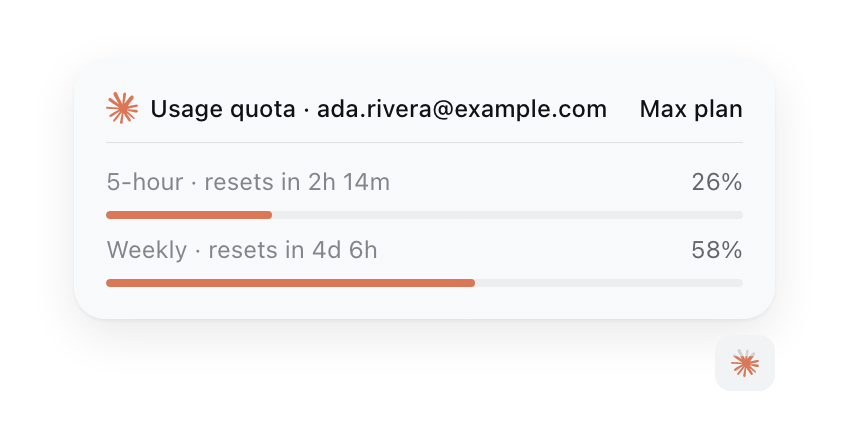
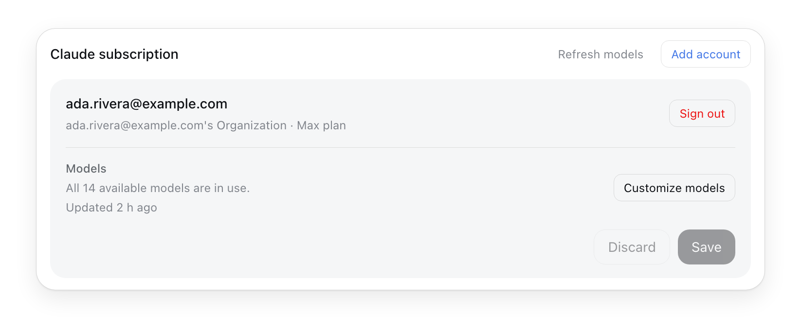

# dsh-claude-subscription

Use Claude models in [DeepSeek Harness](https://github.com/deepseek-ai/deepseek-harness) through your Claude subscription account.

<div align="center">
  <picture>
    <source
      media="(prefers-color-scheme: dark)"
      srcset="images/claude-account-usage-dark.png"
    >
    
  </picture>
</div>

> [!WARNING]
> This project is not official. It is not affiliated with, endorsed by, or supported by Anthropic or DeepSeek Harness, and it comes with no warranty, support, or liability.

## Installation

```sh
dsh plugin --profile web add https://github.com/apcamargo/dsh-claude-subscription.git
```

## Getting started

Sign in from any session:

```
/claude-login
```

It prints an authorization link and opens it in your browser. Approve it there to grant the plugin access to your subscription.

### Using multiple accounts

You can run `/claude-login` multiple times to add additional accounts. Each one becomes its own group in the model picker, labeled with the email associated with it.

Whichever account is signed in at [claude.ai](https://claude.ai/) in your browser is the one that gets added. Sign in to the account you want first, or open the authorization link in a private window.

## Commands

| Command                           | What it does                                     |
| --------------------------------- | ------------------------------------------------ |
| `/claude-login [email]`           | Sign in, add an account, or refresh a credential |
| `/claude-account [account]`       | Show the signed-in account and token expiry      |
| `/claude-usage [account]`         | Show quota usage and reset times                 |
| `/claude-logout [account\|--all]` | Sign out and delete the stored credentials       |

## Usage indicator

When the selected model belongs to a subscription account, a small Claude mark appears in the message composer to the left of its model selector. Its colored fill drains as your primary quota has been used, and clicking it opens a panel with detailed information.

<div align="center">
  <picture>
    <source
      media="(prefers-color-scheme: dark)"
      srcset="images/claude-usage-indicator-dark.png"
    >
    
  </picture>
</div>

## Models page

The plugin adds a "Claude subscription" section to the Models page in Settings. It lists each signed-in account, the model catalog, and lets you edit the model list per account.

<div align="center">
  <picture>
    <source
      media="(prefers-color-scheme: dark)"
      srcset="images/claude-models-card-dark.png"
    >
    
  </picture>
</div>

## Development

```sh
npm install
# Rebuild lib/client.js and executes unit tests
npm test
# Mount the plugin through the real cordis runtime
npm run verify
# Regenerate lib/client.js after editing client-app.js or client-models.js
npm run build:client
# Regenerate the README figures using a local headless Chromium
npm run images
```
